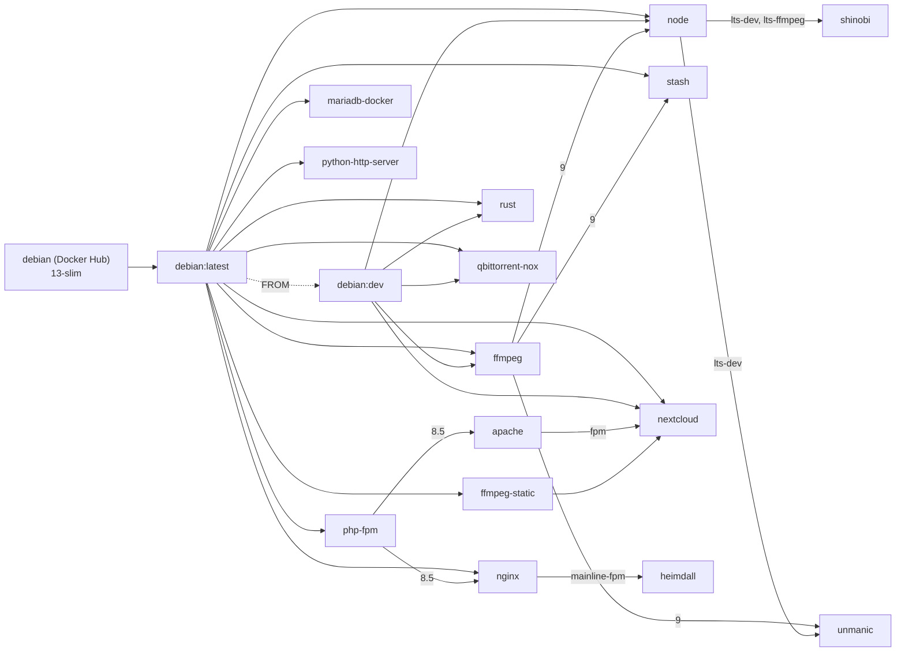

# dockerized

Personally tailored Docker images. Each folder is one image (or one family of images) with its own `Dockerfile`; most of them are built on a shared Debian base so the whole set can be upgraded by rebuilding a few base images and the things on top of them.

* 49 image folders, 16 of them with a `make-image.sh` build recipe
* A single script, [`upgrade-v2.sh`](#building-and-upgrading), rebuilds and pushes them in dependency order
* Images are pushed to a private registry (`192.168.0.2:6060/dedyms` by default); some are also published on Docker Hub under `martadinata666` (for example `ffmpeg-static` and `nextcloud`)

## Contents

- [Base image and conventions](#base-image-and-conventions)
- [How the images depend on each other](#how-the-images-depend-on-each-other)
- [Building and upgrading](#building-and-upgrading)
- [Versions and build arguments](#versions-and-build-arguments)
- [Image index](#image-index)
- [Adding a new image](#adding-a-new-image)
- [Other files](#other-files)
- [License](#license)

## Base image and conventions

`debian/` builds the base everything else starts from. It produces two tags from the same Debian release:

| Tag | Dockerfile | Purpose |
|---|---|---|
| `debian:latest` (also `debian:<version>`, e.g. `debian:13`) | `debian/Dockerfile`, `FROM debian:${VERSION}-slim` | runtime base |
| `debian:dev` | `debian/Dockerfile.dev`, `FROM debian:latest` | build tools, used for build stages |

Both are meant to be rebuilt together. Common conventions in the base image (see `debian/Dockerfile`):

* runs as a non-root user `docker` (`UID`/`GID` build arguments, default 1000) with passwordless `sudo`
* `TZ=Asia/Jakarta`, `LANG`/`LC_ALL=en_US.UTF-8`
* `tini` as init, plus common tools (`curl`, `nano`, `htop`, `ncdu`, `aria2` and `apt-fast`)

Images are usually multi-stage: a `debian:dev` (or `node:lts-dev`) stage builds the software, and the final stage starts from the runtime tag (`debian:latest`, `node:lts`, ...).

## How the images depend on each other

Images that have a `make-image.sh` (the ones that other images are built on, plus several apps):



`apache`, `nginx` and `stash` also copy from `yacron:ci`. `yacron` has no `make-image.sh`, so it is not in the chart or in the upgrade script and has to be built separately (its `Dockerfile` starts `FROM debian:dev`).

Build order used by `upgrade-v2.sh`: `debian` → `ffmpeg`, `ffmpeg-static`, `php-fpm`, `rust` → `node` → `apache`, `nginx` → `mariadb` → apps (`qbittorrent-nox`, `stash`, `python-http-server`, `shinobi`, `heimdall`, `unmanic`, `nextcloud`).

## Building and upgrading

`upgrade-v2.sh` replaces the old `upgrade.sh` and the per-folder `make-image.sh` files: every version lives once at the top of the script, and each image's build command is a function in it.

Requirements: Docker with `buildx`, access to the registry, and `curl` + `jq` for the images that look up their latest release on GitHub (you can pass those versions yourself instead).

```bash
./upgrade-v2.sh                       # essential group (debian, ffmpeg, php-fpm, node, apache, nginx, mariadb)
./upgrade-v2.sh auto                  # qbittorrent-nox, stash, python-http-server
./upgrade-v2.sh manual                # shinobi, heimdall, unmanic, nextcloud
./upgrade-v2.sh all                   # every image, bases first
./upgrade-v2.sh stash heimdall        # specific images (always built in dependency order)
./upgrade-v2.sh -n all                # dry run: print the commands only
./upgrade-v2.sh -s PHP_VERSION=8.5.13 php-fpm apache nginx
./upgrade-v2.sh list                  # image names, in build order
```

| Option | Effect |
|---|---|
| `-n`, `--dry-run` | print commands instead of running them |
| `-k`, `--keep-going` | continue with the next image after a failure |
| `-s KEY=VALUE` | override a version for this run (repeatable) |
| `-m`, `--make-image` | run each folder's own `make-image.sh` instead of the built-in commands |
| `--no-push` | build and load locally instead of pushing |
| `--no-prune` | skip `docker buildx prune -f -a` (it normally runs after `essential` or `all` when everything succeeded) |

Environment: `REGISTRY` (default `192.168.0.2:6060/dedyms`) and `DOCKER_PATH` (repo location; default is the folder of the script).

The groups follow the old workflow: **essential** images are rebuilt on every upgrade, **auto** images are safe to rebuild automatically, and **manual** images depend on something important (Shinobi on `node`, Heimdall on `nginx`, Unmanic on `ffmpeg`, Nextcloud on `apache` and `ffmpeg-static`) and are rebuilt by hand. `ffmpeg-static` and `rust` have a build recipe but are not in `upgrade.sh`, so they are in the `extra` group (`all` includes them).

## Versions and build arguments

Defaults are set in the `VERSIONS` block of `upgrade-v2.sh` and can be overridden with an environment variable or `-s`.

| Setting | Default | Used by |
|---|---|---|
| `DEBIAN_VERSION` | `13` | `debian` (`VERSION`), `mariadb-docker` (`VERSION`) |
| `FFMPEG_MAJOR` | `9` | `ffmpeg` tag, and `node`, `stash`, `unmanic` builds |
| `FFMPEG_GIT_TAG` | `n${FFMPEG_MAJOR}.0` | `ffmpeg` (`FFMPEG_VERSION`) |
| `PHP_VERSION` | `8.5.12` | `php-fpm` (`PHP_VERSION`) |
| `PHP_TAG` | `${PHP_VERSION%.*}` | `php-fpm` tag; `apache` and `nginx` (`VERSION`, i.e. `FROM php-fpm:<tag>`) |
| `RUST_VERSION`, `RUSTUP_VERSION` | `1.99.1`, `1.29.3` | `rust` |
| `NEXTCLOUD_RELEASE` | `v35.0.2` | `nextcloud` (pinned on purpose: Nextcloud has many simultaneous versions) |
| `UNMANIC_RELEASE` | `staging` | `unmanic` |

Looked up from GitHub when not set: `NODE_RELEASE` (latest Node LTS) and `NVM_RELEASE`, `HEIMDALL_RELEASE`, `STASH_VERSION`, `PUSH_RELEASE` (Nextcloud `notify_push`), `QBIT_RELEASE`. If a lookup fails the image is skipped with an error rather than built with an empty version.

## Image index

"Built from" shows the `FROM` image(s) in the main `Dockerfile` with its default arguments. `●` marks images with a build recipe in `upgrade-v2.sh`.

| Image | Built from | |
|---|---|---|
| `apache` | `php-fpm`, `yacron:ci` | ● |
| `apprise` | `debian:dev`, `nginx:mainline` | |
| `cadvisor` | `debian:latest` | |
| `debian` | `debian:<version>-slim` (Docker Hub) | ● |
| `docker-binfmt-qemu` | `debian:trixie-slim` (Docker Hub) | |
| `docker-static` | `debian:latest` | |
| `docker-with-buildx` | `debian:latest`, `docker-static` | |
| `dotnet` | `debian:latest` (`dotnet/10.0/Dockerfile`) | |
| `duplicati` | `debian:latest` | |
| `excalidraw` | `Dockerfile.repack` | |
| `ffmpeg` | `debian:dev`, `debian:latest` | ● |
| `ffmpeg-static` | `debian:latest` | ● |
| `fleet` | `jre:11` | |
| `fluentd` | `fluent/fluentd:edge` (Docker Hub) | |
| `github-workflows` | `Dockerfile.ci` | |
| `go` | `debian:latest` | |
| `heimdall` | `nginx:mainline-fpm` | ● |
| `iperf3` | `debian:latest` | |
| `jre` | `debian:latest` | |
| `linkace` | `debian:dev`, `apache:fpm` | |
| `lldap` | `Dockerfile.ci` | |
| `mariadb-docker` | `debian:<version>` (`12.3/Dockerfile.debian`) | ● |
| `nextcloud` | `debian:dev`, `debian:latest`, `apache:fpm`, `ffmpeg-static` | ● |
| `nginx` | `debian:latest`, `php-fpm`, `yacron:ci` (`fpm/Dockerfile`) | ● |
| `node` | `debian:latest`, `debian:dev`, `ffmpeg` (`nvm/Dockerfile*`) | ● |
| `novnc` | `debian:dev`, `debian:latest` | |
| `novnc-desktop` | `node`, `debian:dev` (`openbox/Dockerfile`) | |
| `openssh` | `debian:dev`, `debian:latest` | |
| `php-fpm` | `debian:latest` | ● |
| `pigallery2` | `node`, `ffmpeg-static` | |
| `ping` | `debian:latest` | |
| `pipewire`, `pulseaudio` | no Dockerfile in this checkout | |
| `plex-discord-bot` | `node` | |
| `polaris` | `Dockerfile.ci` | |
| `pyload-ng` | `debian:dev`, `debian:latest` | |
| `python-http-server` | `debian:latest` | ● |
| `qbittorrent-nox` | `debian:dev`, `debian:latest` | ● |
| `rs-http-server` | `Dockerfile.ci` | |
| `rust` | `debian:dev`, `debian:latest` | ● |
| `scrcpy` | `debian:dev` | |
| `scrutiny` | `Dockerfile.collector`, `Dockerfile.app` | |
| `shepherd` | `docker-static` | |
| `shinobi` | `node` (`lts-dev`, `lts-ffmpeg`) | ● |
| `squid` | `debian:dev`, `debian:latest` | |
| `stash` | `debian:latest`, `ffmpeg`, `yacron:ci` | ● |
| `unmanic` | `node`, `ffmpeg` | ● |
| `yacron` | `debian:dev` | |
| `ympd` | `debian:dev`, `debian:latest` | |

Images with only a `Dockerfile.ci`, `.repack` or similar file (no plain `Dockerfile`) are built by their own CI or by hand and are not part of `upgrade-v2.sh`.

## Adding a new image

1. Create a folder with a `Dockerfile` that starts `FROM ${REGISTRY}/debian:latest` (or another image from this repo), using build arguments for versions.
2. Add an `up_<name>()` function to `upgrade-v2.sh` with the `docker buildx build` command, and add the name to the right group and to `ALL` after the images it is built on.
3. Put any new version in the `VERSIONS` block so it can be overridden with `-s`.
4. Check it with `./upgrade-v2.sh -n <name>`.

## Other files

* `sync-github.sh`: maintainer helper that commits the working tree and force-pushes `master` to `origin` (it needs the local `git-disable-repo.sh` helper). Read it before running it.
* `upgrade.sh`: the previous upgrade checklist; superseded by `upgrade-v2.sh`.

## License

[Apache License 2.0](LICENSE)
